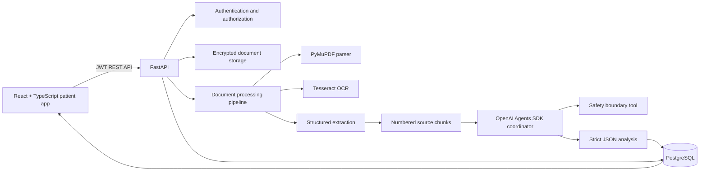

# MediGuide AI

MediGuide AI is a full-stack patient medical record simplification and follow-up intelligence system. Patients can upload PDFs or report images, extract text with PDF parsing or OCR, receive a source-grounded plain-language explanation, organize explicit follow-up instructions, review medication details, and prepare questions for their next medical consultation.

> **Medical safety:** MediGuide is an educational record-organization tool. It does not diagnose disease, prescribe medicine, change doses, independently evaluate drug interactions, or replace a qualified healthcare professional. Users must compare extracted details with the original record and confirm medical decisions with a clinician.

## What is implemented

- Secure registration and JWT authentication with Argon2 password hashing
- Account-isolated medical documents and care records
- PDF text extraction with PyMuPDF
- OCR for scanned PDFs and PNG/JPEG images with Tesseract
- Extraction confidence and low-confidence review warnings
- Structured dates, lab-value candidates, medication candidates and source text
- OpenAI Agents SDK integration with a required safety-policy tool and strict Pydantic output
- Source-grounded explanations with chunk citations
- Safe deterministic processing when no OpenAI key is configured
- Follow-up tracker with completion and reminder state
- Medication organizer that flags every extracted instruction for confirmation
- Medical timeline and record-specific consultation questions
- PostgreSQL schema managed through Alembic
- Optional Fernet encryption for uploaded documents at rest
- Responsive React/TypeScript interface with Tailwind CSS and Lucide icons
- Docker Compose development stack and backend integration tests

## Architecture



The implementation improves the presentation architecture in several ways:

1. Every database query is scoped to the authenticated user.
2. Uploaded files live outside the public frontend and can be encrypted before storage.
3. AI output follows a validated schema rather than free-form text.
4. Extracted medication details always require confirmation.
5. Follow-ups are created only when the record states them.
6. A no-key fallback keeps document parsing and organization functional without pretending that an LLM ran.
7. Source chunks and exact quotes preserve traceability to the uploaded document.

## Repository structure

```text
MediGuide/
├── backend/
│   ├── alembic/                # Database migrations
│   ├── app/
│   │   ├── routers/            # Auth, documents, care and dashboard APIs
│   │   ├── agent_service.py    # Agent orchestration and safe fallback
│   │   ├── document_processing.py
│   │   ├── models.py           # SQLAlchemy entities
│   │   └── main.py
│   └── tests/                  # API and PDF-pipeline tests
├── frontend/
│   └── src/                    # React pages, components, context and API client
├── .env.example
└── docker-compose.yml
```

## Quick start with Docker

Requirements: Docker Desktop and Docker Compose.

```bash
cp .env.example .env
docker compose up --build
```

Open:

- Patient app: <http://localhost:5173>
- API documentation: <http://localhost:8000/docs>
- Health check: <http://localhost:8000/health>

Add `OPENAI_API_KEY` to `.env` to enable the OpenAI agent. Without it, the application uses the conservative local fallback and labels the explanation accordingly.

For encrypted uploads, generate a key and set `FILE_ENCRYPTION_KEY`:

```bash
python -c "from cryptography.fernet import Fernet; print(Fernet.generate_key().decode())"
```

Keep that key stable. Losing it makes encrypted uploads unrecoverable.

## Local development

### 1. PostgreSQL

Start only the database container:

```bash
docker compose up -d db
```

### 2. Backend

```powershell
cd backend
python -m venv .venv
.\.venv\Scripts\Activate.ps1
pip install -r requirements.txt
Copy-Item ..\.env.example ..\.env
alembic upgrade head
uvicorn app.main:app --reload --port 8000
```

SQLite is used automatically when `DATABASE_URL` is absent, which is convenient for tests and a quick local demonstration. PostgreSQL remains the configured application database in `.env.example` and Docker Compose.

Tesseract must be installed on the host for image and scanned-PDF OCR. Digital PDFs work without Tesseract.

### 3. Frontend

```powershell
cd frontend
npm install
npm run dev
```

## Render and Vercel deployment

The repository includes a root-level `render.yaml` Blueprint and `frontend/vercel.json`.

### Render API and PostgreSQL

1. In Render, create a new Blueprint from `https://github.com/akshaya1221/MediGuide`.
2. Render reads `render.yaml` and creates `mediguide-api` plus `mediguide-db` in Singapore.
3. After the API becomes healthy, copy its `https://mediguide-api-....onrender.com` URL.
4. Optionally add `OPENAI_API_KEY` in the web service's environment settings. Without it, the labelled safe fallback remains active.

The free Blueprint uses `/tmp` for uploaded documents, so files are ephemeral and may disappear during restarts or redeploys. For real patient data, upgrade the web service and attach a persistent encrypted disk or move uploads to encrypted object storage before use.

### Vercel frontend

1. Import the same GitHub repository into Vercel.
2. Set the project Root Directory to `frontend` and keep the detected Vite build settings.
3. Add `VITE_API_URL=https://<your-render-service>.onrender.com/api/v1` for Production, Preview and Development.
4. Deploy. The included SPA rewrite keeps React Router routes working on refresh.

The Render service accepts HTTPS origins ending in `.vercel.app`. For a custom domain, replace `CORS_ORIGIN_REGEX` with a narrow expression for that domain or add the exact origin to `CORS_ORIGINS`.

## Tests and validation

```powershell
cd backend
.\.venv\Scripts\python.exe -m pytest -q

cd ..\frontend
npm run build
```

The backend tests cover health, authentication, access control, upload validation, and a real in-memory PDF through the full extraction and explanation pipeline.

## API overview

| Method | Endpoint | Purpose |
|---|---|---|
| `POST` | `/api/v1/auth/register` | Create a patient account |
| `POST` | `/api/v1/auth/login` | Receive a bearer token |
| `GET` | `/api/v1/dashboard` | Summary metrics and pending work |
| `POST` | `/api/v1/documents` | Upload and process a record |
| `GET` | `/api/v1/documents` | List the user's records |
| `GET` | `/api/v1/documents/{id}` | Explanation, sources and extracted data |
| `POST` | `/api/v1/documents/{id}/reprocess` | Rebuild derived data |
| `GET/PATCH` | `/api/v1/care/follow-ups` | Review or update follow-ups |
| `GET` | `/api/v1/care/medications` | Medication organizer |
| `GET` | `/api/v1/care/timeline` | Chronological medical timeline |
| `GET` | `/api/v1/care/questions` | Consultation questions |

## Agent behavior

When `OPENAI_API_KEY` is configured, the coordinator uses the OpenAI Agents SDK and strict `AgentAnalysis` output. The agent must call a safety-boundary function tool before it returns an answer. Its prompt limits the model to numbered chunks from the patient's record and requires exact short source quotes.

This project deliberately avoids general medical web retrieval. The RAG context comes from the user's uploaded document, which reduces unsupported claims and keeps citations auditable.

## Privacy and security notes

- `.env`, upload storage, local databases and generated logs are ignored by Git.
- Passwords use Argon2 and are never stored in plaintext.
- JWT tokens expire and every resource query checks record ownership.
- File type, size and duplicate hash are validated before processing.
- Production deployments should set a strong `SECRET_KEY`, `FILE_ENCRYPTION_KEY`, HTTPS, encrypted PostgreSQL storage, restricted CORS origins, malware scanning, object-storage retention rules, rate limits, backups and centralized audit logs.
- This academic system is not certified as a medical device and does not by itself establish regulatory compliance.

See [SECURITY.md](SECURITY.md) for deployment and disclosure guidance.

## Evaluation plan

The presentation's evaluation framework is preserved:

- Information extraction: precision, recall and F1 for dates, tests, values and medicines
- Follow-up extraction: accuracy against explicitly stated instructions
- OCR: character or word accuracy on scanned records
- Patient comprehension: original record versus simplified explanation
- Usability: System Usability Scale (SUS)

No evaluation scores are claimed until a study is conducted.

## License and responsible use

This repository is intended for academic development and supervised demonstrations. Do not use real patient data in a public or unapproved environment.

